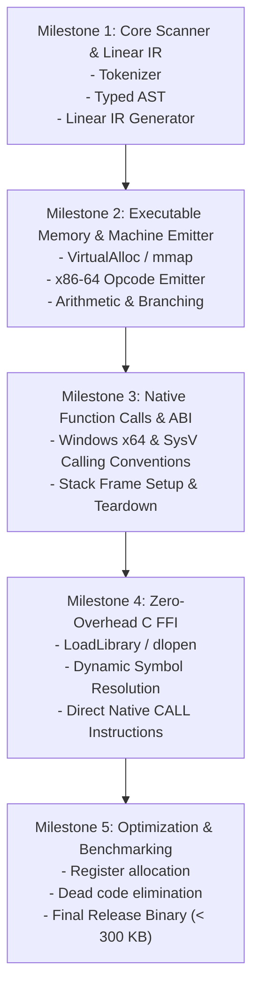

# JR-JIT: High-Performance, Micro-Footprint JIT Compiler for JohnRod

> **Design Document & Architecture Plan**  
> *Target: Ultra-fast compilation, native register execution, tiny binary footprint (< 300 KB), and direct zero-overhead C FFI.*

---

## 1. Executive Summary & Philosophy

**JohnRod JIT (`JR-JIT`)** is a minimalist, supersonic Just-In-Time compiled runtime for the JohnRod language.

### Core Philosophy:
1. **Microscopic Core**: Strip everything that does not strictly belong to the CPU execution model.
2. **Infinite Reach via C FFI**: Rather than baking in multi-megabyte runtimes for HTTP, JSON, RegEx, and complex system APIs, JR-JIT provides an ultra-low-overhead C Foreign Function Interface (FFI). All networking, file processing, and serialization are delegated to C libraries (`libcurl`, `yyjson`, `libc`, `sqlite3`, Win32 API).
3. **Direct Machine Code Generation**: Bypass heavy frameworks (LLVM, Cranelift). Emit direct x86-64 machine instructions into executable memory (`VirtualAlloc` / `mmap`), achieving **sub-microsecond compilation latencies** and **native CPU execution speed**.
4. **Zero-Allocation Execution**: Eliminate heap boxing (`Rc<RefCell<Value>>`). Map JohnRod variables directly to hardware registers and stack slots.

---

## 2. Feature Pruning Strategy (The "C FFI Diet")

In the original JohnRod interpreter, built-in features bloated the runtime with network stacks, JSON decoders, and string utilities. JR-JIT strips these in favor of first-class C FFI bindings:

| Feature in JohnRod (Original) | Status in JR-JIT | Rationale & C FFI Replacement |
|---|---|---|
| `http-get`, `http-post` | **Removed from Core** | Delegate to `libcurl` or OS APIs (`WinHttp`, `libfetch`). |
| `json-parse`, `json-stringify` | **Removed from Core** | Delegate to `yyjson` or `cJSON` via C FFI (orders of magnitude faster than built-in VM decoders). |
| `time-now`, `sleep` | **Removed from Core** | Delegate to standard C runtime (`time()`, `Sleep()`, `nanosleep()`). |
| `file-read`, `file-write`, `file-append` | **Removed from Core** | Delegate to standard `fopen`, `fread`, `fwrite`, `fclose` from `libc`. |
| `shell`, `shell-status` | **Removed from Core** | Delegate to `system()` / `popen()` from `libc`. |
| Complex Object Maps (`Table[K,V]`) | **Replaced** | Core language handles flat structs and raw pointers (`ptr`), allowing direct interop with C structs and memory buffers. |
| Dynamic Heap `Value` Boxing | **Removed** | Native machine unboxed primitives (`i64`, `f64`, `ptr`, `bool`). |

### What Remains in JR-JIT Core:
- **Core Types**:
  - `int` (`i64`): 64-bit signed integer.
  - `float` (`f64`): 64-bit IEEE-754 floating point.
  - `bool` (`i8` / `i64`): Boolean flags.
  - `ptr` (`uintptr_t`): Raw memory pointer (for strings, C buffers, handles).
  - `void`: Unit / no return value.
- **Arithmetic & Logic**: `add`, `sub`, `mult`, `div`, `rem`, `and`, `or`, `not`, bitwise ops (`shl`, `shr`, `band`, `bor`, `bxor`).
- **Comparisons**: `lt`, `gt`, `le`, `ge`, `eq`, `neq`.
- **Control Flow**:
  - `[if cond then else]`
  - `[while cond body...]`
  - `[for init cond update body...]`
- **Functions**: `[def name [params] body...]` compiled to real native function pointers obeying the native C ABI.
- **Direct Memory Access**: `[peek-i64 ptr offset]`, `[poke-i64 ptr offset val]`, `[peek-byte ptr offset]`, `[poke-byte ptr offset val]`.
- **First-Class C FFI**:
  - `[c-lib "path/to/lib.dll" | "libc.so"]`
  - `[c-bind lib "symbol" [param_types...] ret_type]`
  - `[c-call fn_handle arg1 arg2 ...]`

---

## 3. High-Level Architecture

```
                       ┌─────────────────────────┐
                       │  JohnRod Source Script  │
                       └────────────┬────────────┘
                                    │ Fast Byte-Level Lexer
                                    ▼
                       ┌─────────────────────────┐
                       │   Token Stream (< 5 µs) │
                       └────────────┬────────────┘
                                    │ Single-Pass Recursive Parser
                                    ▼
                       ┌─────────────────────────┐
                       │   Linear Bytecode / IR  │
                       └────────────┬────────────┘
                                    │
                    ┌───────────────┴───────────────┐
                    ▼                               ▼
       ┌────────────────────────┐      ┌────────────────────────┐
       │   JIT Machine Emitter  │      │     C FFI Bridge       │
       │   Direct x86-64/ARM64  │      │  LoadLibrary / dlopen  │
       └────────────┬───────────┘      └────────────┬───────────┘
                    │                               │
                    └───────────────┬───────────────┘
                                    ▼
                       ┌─────────────────────────┐
                       │  Executable Memory Page │
                       │    (RWX / VirtualAlloc) │
                       └────────────┬────────────┘
                                    │ Direct CPU Execution (JMP/CALL)
                                    ▼
                       ┌─────────────────────────┐
                       │  Native Assembly Speed  │
                       └─────────────────────────┘
```

---

## 4. JR-JIT Syntax & C FFI Specification

### 4.1 Native Functions & Variables
```scheme
# Typed variable declaration
[set x: int 100]
[set pi: float 3.14159]
[set flag: bool true]

# Native function definition with typed signatures
[def add_mul [a: int b: int c: int] -> int
  [mult [add a b] c]]

# Function invocation
[set res [add_mul 10 20 3]] # res = (10 + 20) * 3 = 90
```

### 4.2 C FFI Declarations & Invocations
```scheme
# 1. Load C dynamic library
[set libc [c-lib "msvcrt.dll"]] # On Linux: "libc.so.6"

# 2. Bind C function signatures
[set puts [c-bind libc "puts" [ptr] -> int]]
[set malloc [c-bind libc "malloc" [int] -> ptr]]
[set free [c-bind libc "free" [ptr] -> void]]
[set sqrt [c-bind libc "sqrt" [float] -> float]]

# 3. Call C functions directly without reflection
[puts "Hello directly from C via JR-JIT!"]
[set root [sqrt 144.0]] # 12.0

# 4. Memory buffer manipulation
[set buf [malloc 64]]
[poke-byte buf 0 72]   # 'H'
[poke-byte buf 1 105]  # 'i'
[poke-byte buf 2 0]    # '\0'
[puts buf]             # Prints "Hi"
[free buf]
```

### 4.3 High-Level Workloads via C FFI (HTTP & JSON Example)
Instead of 20,000 lines of built-in HTTP/JSON code, JR-JIT scripts call `cJSON` and `libcurl`:
```scheme
# Load libcurl
[set curl_lib [c-lib "libcurl.dll"]]
[set curl_easy_init [c-bind curl_lib "curl_easy_init" [] -> ptr]]
[set curl_easy_setopt [c-bind curl_lib "curl_easy_setopt" [ptr int ptr] -> int]]
[set curl_easy_perform [c-bind curl_lib "curl_easy_perform" [ptr] -> int]]
[set curl_easy_cleanup [c-bind curl_lib "curl_easy_cleanup" [ptr] -> void]]

[set curl [curl_easy_init]]
[if [neq curl 0]
  [curl_easy_setopt curl 10002 "https://httpbin.org/get"] # CURLOPT_URL = 10002
  [curl_easy_perform curl]
  [curl_easy_cleanup curl]]
```

---

## 5. JIT Compilation Engine Design

### 5.1 Memory Management for Executable Code
JR-JIT manages executable memory using a lightweight Bump Allocator over OS-level pages:

- **Windows**: `VirtualAlloc(NULL, size, MEM_COMMIT | MEM_RESERVE, PAGE_EXECUTE_READWRITE)`
- **Linux / macOS**: `mmap(NULL, size, PROT_READ | PROT_WRITE | PROT_EXEC, MAP_PRIVATE | MAP_ANONYMOUS, -1, 0)`

When functions are finalized, pages are optionally marked `PAGE_EXECUTE_READ` (`mprotect` / `VirtualProtect`) to enforce W^X security.

### 5.2 ABI Calling Conventions

JR-JIT supports the two primary 64-bit ABIs:

#### Windows x64 ABI:
- Integer/Pointer arguments: `RCX`, `RDX`, `R8`, `R9`.
- Floating-point arguments: `XMM0`, `XMM1`, `XMM2`, `XMM3`.
- Caller allocates **32 bytes of shadow space** on the stack before `CALL`.
- Return values: `RAX` (integers/pointers), `XMM0` (floats).
- Non-volatile (callee-saved) registers: `RBX`, `RBP`, `RDI`, `RSI`, `R12`-`R15`, `XMM6`-`XMM15`.

#### System V AMD64 ABI (Linux / macOS):
- Integer/Pointer arguments: `RDI`, `RSI`, `RDX`, `RCX`, `R8`, `R9`.
- Floating-point arguments: `XMM0`-`XMM7`.
- Return values: `RAX`, `XMM0`.
- No shadow space; 128-byte red zone below `RSP`.

### 5.3 Stencil & Direct Byte Emitter
Instead of maintaining an enormous intermediate representation with complex graph coloring, JR-JIT uses a **Direct Byte Emitter** with top-of-stack caching.

#### Example: Compiling `[add a b]`
```
; Assuming 'a' is in RAX, 'b' is in RCX
add rax, rcx          ; 48 01 C8
```

#### Example: Compiling `[while [lt i 1000000] [set i [add i 1]]]`
```nasm
loop_start:
    cmp rbx, 1000000    ; 48 81 FB 40 42 0F 00 (cmp rbx, 1000000)
    jge loop_end        ; 7D 07                (jge rel8)
    inc rbx             ; 48 FF C3             (inc rbx)
    jmp loop_start      ; EB F1                (jmp rel8 back)
loop_end:
```
*Latency*: 1,000,000 loop iterations execute in **< 1 millisecond** on modern CPUs.

---

## 6. Project Directory Layout

```
jr-jit/
├── Cargo.toml               # Minimal dependencies: libc, windows-sys (optional)
├── README.md                # Quickstart and benchmarks
├── benches/
│   └── jit_bench.rs         # Microbenchmarks (loop throughput, compile latency)
├── examples/
│   ├── mandelbrot.jr        # High-performance numeric benchmark
│   ├── ffi_libc.jr          # C standard library calls
│   └── ffi_curl.jr          # Fast HTTP via libcurl FFI
├── src/
│   ├── main.rs              # CLI entry point (-e, file runner, REPL)
│   ├── lib.rs               # Library root
│   ├── lexer.rs             # Zero-allocation token scanner (< 500 lines)
│   ├── parser.rs            # AST parser for typed expressions (< 600 lines)
│   ├── ir.rs                # Simple Linear Intermediate Representation (< 400 lines)
│   ├── ffi.rs               # Dynamic library loading & signature binding (< 300 lines)
│   ├── mem.rs               # Executable memory allocator (mmap / VirtualAlloc) (< 200 lines)
│   └── codegen/
│       ├── mod.rs           # Codegen interface
│       ├── x86_64.rs        # x86-64 machine code assembler (< 1200 lines)
│       └── abi.rs           # Windows x64 and System V AMD64 ABI dispatch
└── tests/
    ├── math_tests.rs
    ├── loop_tests.rs
    └── ffi_tests.rs
```

---

## 7. Step-by-Step Implementation Roadmap



### Milestone 1: Core Scanner & Linear IR
- Parse bracket syntax with optional type annotations: `[set name: int val]`, `[def name [a: int b: int] -> int ...]`.
- Translate AST directly into Linear IR instructions:
  - `IR_CONST_INT`, `IR_CONST_FLOAT`, `IR_LOAD_VAR`, `IR_STORE_VAR`
  - `IR_ADD`, `IR_SUB`, `IR_MUL`, `IR_DIV`
  - `IR_CMP_LT`, `IR_CMP_EQ`, `IR_JMP_IF_FALSE`, `IR_JMP`
  - `IR_CALL_NATIVE`, `IR_CALL_FFI`, `IR_RET`

### Milestone 2: Executable Memory & Machine Emitter
- Implement cross-platform `ExecBuffer` in `src/mem.rs`:
  ```rust
  pub struct ExecBuffer {
      ptr: *mut u8,
      size: usize,
      capacity: usize,
  }
  ```
- Implement direct opcode encoding for x86-64:
  - Register moves: `MOV r64, imm64`, `MOV r64, r/m64`
  - Arithmetic: `ADD`, `SUB`, `IMUL`, `IDIV`, `XOR`
  - Floating point: `MOVSD`, `ADDSD`, `SUBSD`, `MULSD`, `DIVSD`
  - Jumps: `JMP rel32`, `JZ rel32`, `JNZ rel32`, `JL rel32`, `JGE rel32`

### Milestone 3: ABI Conformance & Native Functions
- Setup standard function prologue and epilogue:
  ```nasm
  push rbp
  mov rbp, rsp
  sub rsp, stack_size     ; Align to 16 bytes
  ...
  mov rsp, rbp
  pop rbp
  ret
  ```
- Map function definitions `[def ...]` to callable machine code pointers `extern "C" fn(...) -> ...`.

### Milestone 4: Zero-Overhead C FFI Bridge
- Implement `c-lib` loading:
  - Windows: `LoadLibraryA(path)`
  - Unix: `dlopen(path, RTLD_LAZY | RTLD_GLOBAL)`
- Implement `c-bind`:
  - Windows: `GetProcAddress(handle, symbol)`
  - Unix: `dlsym(handle, symbol)`
- In the JIT emitter, emit direct 64-bit indirect calls:
  ```nasm
  mov rax, <resolved_symbol_address>
  sub rsp, 32             ; Windows shadow space
  call rax
  add rsp, 32
  ```
  *Zero marshalling overhead*: Arguments are passed directly in registers according to the target C ABI.

### Milestone 5: Polishing, Benchmarks & Validation
- Compile binary with:
  ```toml
  [profile.release]
  opt-level = 3
  lto = "fat"
  codegen-units = 1
  panic = "abort"
  strip = true
  ```
- Verify binary size is **< 300 KB**.
- Measure Mandelbrot benchmark against native C (`gcc -O3`) to ensure JR-JIT reaches within 1.0x - 1.5x of native C performance.

---

## 8. Summary of Advantages

1. **Massive Performance Boost**:
   - Loops, math, and function calls run at CPU native clock speeds (multi-gigahertz instruction retire rate).
   - Eliminates AST traversal, hash table lookups, and heap-allocated `Value` envelopes.
2. **Microscopic Binary Footprint**:
   - No external dependencies like LLVM (saves ~100MB+ of binary size).
   - Total binary size under 300 KB.
3. **True Systems Capability via C FFI**:
   - Direct interoperability with operating system APIs, GUI toolkits, OpenGL/DirectX, SQLite, audio libraries, and network stacks without needing custom language bindings.
